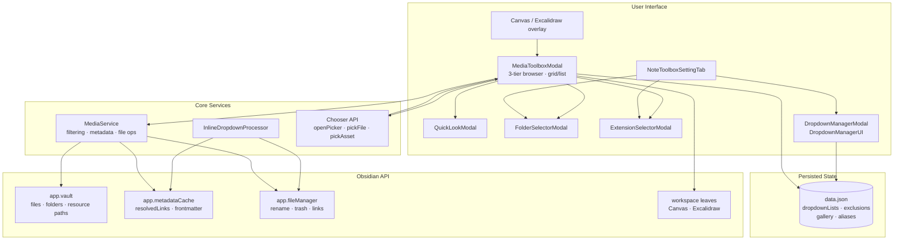
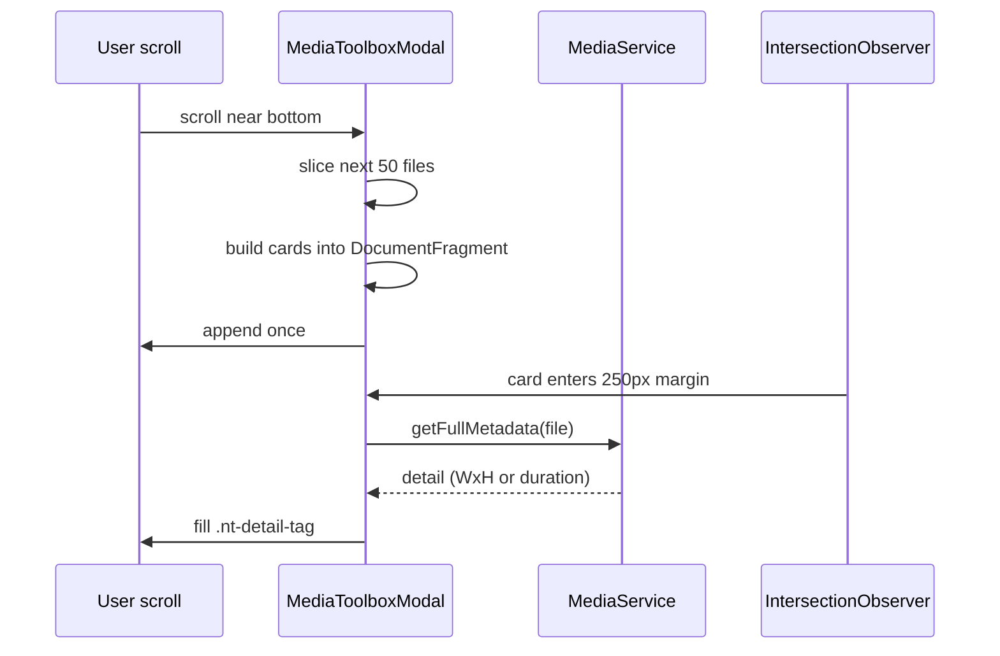

# System Architecture (`ARCHITECTURE.md`)
> **1-Line Summary:** Plain-English map of how the toolbox UI, data service, and Obsidian APIs fit together, plus the checks and recipes needed to change them safely.

## 1. High-Level Visual System Map


## 2. Tech Stack & Why We Chose It

| Layer | Tool / Library | Plain-English Reason Why |
| --- | --- | --- |
| Host | Obsidian plugin API | Assets and dropdowns must live inside the user's vault and editor. |
| Language | TypeScript 5 (strict, `noUncheckedIndexedAccess`) | Vault metadata and settings are loosely shaped; strict types catch assumptions during the port. |
| Bundler | esbuild (CommonJS output) | Obsidian loads one `main.js`; esbuild keeps the production build a single command. |
| UI | Plain DOM through `createEl` / `setIcon` | No framework stays light and inherits theme variables automatically. |
| Virtualization | `content-visibility` CSS + `DocumentFragment` + `IntersectionObserver` | Thousands of cards render without paying layout cost for off-screen tiles. |
| Persistence | `loadData` / `saveData` | Native plugin data storage, matching the live `data.json` keys. |

## 3. Core Subsystems & Engineering Tricks

### [SUBSYSTEM: Media-Data-Service] | Aliases: MediaService, filtering, link graph, metadata, rename
> **1-Line Summary:** A headless service that indexes media files, caches the resolved-link graph, decodes dimensions, and performs collision-safe file operations.
* **How It Works (Plain English):** `getValidFiles` filters by category, folder, extension, exclusions, usage, and search, then sorts with shared collators. `getFullMetadata` reads image/video/audio dimensions behind a 1.5 s timeout and caches them by mtime and size. Rename, move, and batch operations always go through `app.fileManager` so backlinks update.
* **Code Anchors (Grep Targets):**
  * `src/media.ts` -> `MediaService.getValidFiles`, `MediaService.getLinkedFilePaths`, `MediaService.getFullMetadata`
  * `src/media.ts` -> `MediaService.batchRename`, `MediaService.moveFiles`, `MediaService.purgeFolder`

### [SUBSYSTEM: Asset-Browser-Modal] | Aliases: MediaToolboxModal, grid, list, toolbar
> **1-Line Summary:** The main modal owns filter state, builds the three toolbar tiers, and re-renders the viewport on every filter change.
* **How It Works (Plain English):** `render()` constructs header, navigation, filter, and action rows once, then `renderViewport()` recomputes the file list and rebuilds either the grid or the table. Grid geometry is recalculated from the viewport height so exactly N rows fit. Opening as a picker swaps Insert for Choose and resolves through `resolvePicker`.
* **Code Anchors (Grep Targets):**
  * `src/media-toolbox.ts` -> `MediaToolboxModal.render`, `MediaToolboxModal.renderViewport`
  * `src/media-toolbox.ts` -> `MediaToolboxModal.renderGridView`, `MediaToolboxModal.renderListView`
  * `src/media-toolbox.ts` -> `MediaToolboxModal.applyGalleryLayout`, `MediaToolboxModal.resolvePicker`

### [SUBSYSTEM: Lazy-Rendering-And-Metadata] | Aliases: virtualization, IntersectionObserver, content-visibility, pagination
> **1-Line Summary:** Renders 50 assets per batch, appends more on scroll, and decodes dimensions only when a card approaches the viewport.
* **How It Works (Plain English):** Cards and rows are built into a `DocumentFragment` and committed at once. An `IntersectionObserver` with a 250 px root margin hydrates the hidden detail chip. Scroll handling is throttled with `requestAnimationFrame`; `content-visibility: auto` in `styles.css` lets Chromium skip off-screen paint.
* **Data Flow Diagram:**

* **Code Anchors (Grep Targets):**
  * `src/media-toolbox.ts` -> `MediaToolboxModal.setupIntersectionObserver`, `MediaToolboxModal.hydrateEntry`
  * `src/media-toolbox.ts` -> `MediaToolboxModal.renderViewport` (scroll handler)

### [SUBSYSTEM: Selection-And-Insertion-Engine] | Aliases: shift click, insert, markdown, canvas, excalidraw, clipboard
> **1-Line Summary:** Converts a path set into TFiles with O(1) vault lookups and routes them to Markdown, Canvas, Excalidraw, or the clipboard.
* **How It Works (Plain English):** Grid and list share `handleCardClick`, which supports single-select, toggle, and Shift ranges. `getSelectedFiles` resolves each path with `getAbstractFileByPath` instead of scanning. `insertTargetFile` detects the target view, embeds with `generateMarkdownLink`, and adds `!` for non-document media. Canvas and Excalidraw use their public APIs; the final fallback copies links.
* **Code Anchors (Grep Targets):**
  * `src/media-toolbox.ts` -> `MediaToolboxModal.getSelectedFiles`, `MediaToolboxModal.handleCardClick`
  * `src/media-toolbox.ts` -> `MediaToolboxModal.insertTargetFile`, `MediaToolboxModal.handleInsertSelected`
  * `src/main.ts` -> `NoteToolboxPlugin.injectOverlayButtons`

### [SUBSYSTEM: Exclusion-And-Settings] | Aliases: folder picker, extension picker, chips, settings
> **1-Line Summary:** Exclusion pickers edit the same settings arrays that the browser reads, and the settings tab mirrors them as removable chips and raw text.
* **How It Works (Plain English):** Folder and extension modals keep local selection sets, offer filtered Select All/Clear/Invert, and hand the final array back through `onSave`. The settings tab re-renders chips after every change and keeps the textarea in sync. Both feed `settings.excludedFolders` / `excludedExtensions`, which `getValidFiles` applies before any display.
* **Code Anchors (Grep Targets):**
  * `src/exclusions.ts` -> `FolderSelectorModal`, `ExtensionSelectorModal`
  * `src/settings-tab.ts` -> `NoteToolboxSettingTab.display` (`renderFolderChips`, `renderExtChips`)

### [SUBSYSTEM: Inline-Dropdown-Pipeline] | Aliases: post-processor, frontmatter, ?[list], inline select
> **1-Line Summary:** A Markdown post-processor replaces `?[list]` text nodes with selects and writes changes atomically.
* **How It Works (Plain English):** A cheap `textContent.includes("?[")` guard avoids tree walking for ordinary notes. The processor collects text nodes outside code/pre/textarea, matches list and optional inline value, and builds selects. A property-bound change calls `processFrontMatter`; an inline change edits the active editor range or falls back to `vault.process`.
* **Code Anchors (Grep Targets):**
  * `src/dropdown.ts` -> `InlineDropdownProcessor.process`, `InlineDropdownProcessor.handleChange`
  * `src/main.ts` -> `NoteToolboxPlugin.onload` (`registerMarkdownPostProcessor`)

### [SUBSYSTEM: Dropdown-List-Manager] | Aliases: DropdownManagerUI, options, reorder, list editor
> **1-Line Summary:** A reusable builder edits `settings.dropdownLists` in place and re-renders after every persisted mutation.
* **How It Works (Plain English):** The UI lists dropdown names as chips, supports create/rename/delete, and shows the active list’s options. Selection supports Shift ranges and bulk delete; option edits, reorders, and removals save immediately. The same component appears in the standalone modal and at the bottom of settings.
* **Code Anchors (Grep Targets):**
  * `src/dropdown-manager.ts` -> `DropdownManagerUI.render`, `DropdownManagerUI.saveAndRefresh`
  * `src/dropdown-manager-modal.ts` -> `DropdownManagerModal.onOpen`

### [SUBSYSTEM: Public-Chooser-API] | Aliases: openPicker, pickFile, pickAsset, inter-plugin
> **1-Line Summary:** The plugin instance exposes normalized picker methods and rich asset payloads for other plugins.
* **How It Works (Plain English):** `openPicker` normalizes options into `PickerConfig` and opens the toolbox. Category presets lock the category chip row. `pickFile` wraps the callback API in a Promise and resolves `null` on cancel; `pickAsset` sets `returnPayload`. `createAssetPayload` includes file, paths, category, resource URL, Markdown link, and base metadata.
* **Code Anchors (Grep Targets):**
  * `src/main.ts` -> `NoteToolboxPlugin.openPicker`, `pickFile`, `pickAsset`, `createAssetPayload`
  * `src/types.ts` -> `ChooserOptions`, `AssetPayload`, `PickerConfig`

### [SUBSYSTEM: Lifecycle-And-Overlays] | Aliases: onload, events, canvas button, unload
> **1-Line Summary:** The entry point registers commands, aliases, ribbon, workspace overlays, cache invalidation, and teardown.
* **How It Works (Plain English):** `onload` loads settings, applies the glassmorphism class, creates `MediaService`, registers two commands and aliases, injects a ribbon icon, and wires layout-change events to a debounced overlay injector. Vault delete/rename and metadata resolved events clear caches. `onunload` removes the body class and every injected overlay button.
* **Code Anchors (Grep Targets):**
  * `src/main.ts` -> `NoteToolboxPlugin.onload`, `NoteToolboxPlugin.onunload`, `NoteToolboxPlugin.registerAliases`

### [SUBSYSTEM: Build-And-Persistence] | Aliases: esbuild, data.json, manifest, release
> **1-Line Summary:** One esbuild command bundles `src/main.ts` to root `main.js`; settings persist under stable `data.json` keys.
* **How It Works (Plain English):** `npm run build` runs `tsc -noEmit -skipLibCheck` and then `node esbuild.config.mjs production`. Obsidian loads `main.js`, `manifest.json`, and `styles.css` from the plugin folder. `DEFAULT_SETTINGS` defines every key read by the UI; renaming a key without migration discards user data.
* **Verification Commands:**
```bash
npx tsc -noEmit -skipLibCheck
npm run lint
npm run build
```
* **Code Anchors (Grep Targets):**
  * `esbuild.config.mjs`, `manifest.json`
  * `src/settings.ts` -> `DEFAULT_SETTINGS`
  * `src/main.ts` -> `NoteToolboxPlugin.loadSettings`, `NoteToolboxPlugin.saveSettings`

## 4. Extension Recipes

### Add a media category
1. Add the extension set to `EXTENSIONS` in `src/fuzzy.ts`.
2. Return a new `FileCategory` from `getCategory`.
3. Add the category to `categories` in `MediaToolboxModal.render` and to the extension picker tabs in `src/exclusions.ts`.

### Add a toolbar operation
1. Add a button to `opsGroup` in `MediaToolboxModal.render`.
2. Implement a handler that calls `getSelectedFiles()`.
3. Use `app.fileManager` for filesystem changes and end with `renderViewport(false)` plus a `Notice`.

### Add a settings key
1. Extend `NoteToolboxSettings` and `DEFAULT_SETTINGS`.
2. Add the control in `NoteToolboxSettingTab.display`.
3. Read it from the service or modal; never mutate defaults in place.
