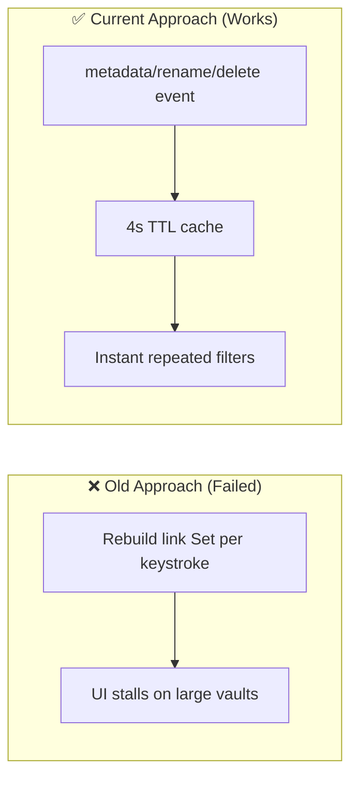
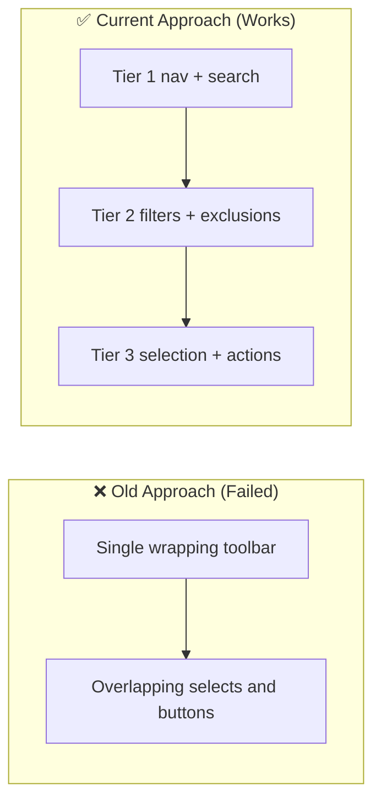

# Architectural Decisions, Pivots & Landmines (`DECISIONS_AND_TRAPS.md`)
> **1-Line Summary:** Why each non-obvious mechanism exists, which broken approach it replaced, and what must never be changed.

## 1. Architectural Decisions & Pivot History

### [DECISION: TTL-Link-Graph-Cache] | Aliases: orphans, resolvedLinks, search performance, cache
> **1-Line Summary:** The resolved-link graph is cached for four seconds and cleared by metadata, rename, and delete events.
* **Decision Maker:** `[DECIDED BY: HUMAN]` (performance fix in the live architecture notes)
* **Original User Intention:** Filtering by Unused/Orphans and typing in search must stay responsive in vaults with tens of thousands of links.
* **Options Considered:**
  * **Option A (Rejected):** Rebuild the link set on every render — each keystroke walked every resolved link.
  * **Option B (Chosen):** Cache the `Set` with a 4 s TTL plus explicit invalidation from `metadataCache.on("resolved")` and vault rename/delete.
* **Visual Pivot Map (What Failed vs. What Works):**

* **Code Anchors (Grep Targets):**
  * `src/media.ts` -> `MediaService.getLinkedFilePaths`, `MediaService.clearLinkedCache`
  * `src/main.ts` -> `NoteToolboxPlugin.onload`

### [DECISION: Shared-Intl-Collators] | Aliases: sorting, localeCompare, Intl.Collator
> **1-Line Summary:** Name and extension sorts reuse two module-level `Intl.Collator` instances instead of allocating one per comparison.
* **Decision Maker:** `[DECIDED BY: HUMAN]`
* **Original User Intention:** Alphabetical sorting must be fast and stable across large asset lists.
* **Options Considered:**
  * **Option A (Rejected):** `a.name.localeCompare(b.name, undefined, { numeric: true })` inside the comparator — spawns a collation engine thousands of times.
  * **Option B (Chosen):** `sharedNameCollator` and `sharedExtCollator` created once in `src/fuzzy.ts`.
* **Code Anchors (Grep Targets):**
  * `src/fuzzy.ts` -> `sharedNameCollator`, `sharedExtCollator`
  * `src/media.ts` -> `MediaService.getValidFiles`

### [DECISION: O1-Selection-Lookups] | Aliases: getSelectedFiles, getAbstractFileByPath, drag freeze
> **1-Line Summary:** Selected paths resolve to TFiles with direct vault lookups, not a full vault scan.
* **Decision Maker:** `[DECIDED BY: HUMAN]`
* **Original User Intention:** Clicking, dragging, or trashing a small selection must not freeze on vaults with 10,000+ files.
* **Options Considered:**
  * **Option A (Rejected):** `app.vault.getFiles().filter(f => selected.has(f.path))` on every interaction.
  * **Option B (Chosen):** Iterate the selected path set and call `app.vault.getAbstractFileByPath` for each.
* **Code Anchors (Grep Targets):**
  * `src/media-toolbox.ts` -> `MediaToolboxModal.getSelectedFiles`

### [DECISION: Atomic-Frontmatter-Updates] | Aliases: processFrontMatter, YAML, dropdown property
> **1-Line Summary:** Property-bound dropdowns write through Obsidian’s frontmatter API, never by string replacement.
* **Decision Maker:** `[DECIDED BY: HUMAN]`
* **Original User Intention:** Changing a dropdown must not corrupt multiline properties, arrays, or nested YAML.
* **Options Considered:**
  * **Option A (Rejected):** Regex replacement of `dropdown_key: value` in the raw note text — broke complex YAML.
  * **Option B (Chosen):** `app.fileManager.processFrontMatter(file, fm => { fm[key] = value })`.
* **Code Anchors (Grep Targets):**
  * `src/dropdown.ts` -> `InlineDropdownProcessor.handleChange`

### [DECISION: 1500ms-Metadata-Timeout] | Aliases: corrupted media, hanging promise, dimensions, duration
> **1-Line Summary:** Every image, video, and audio decode race is bounded by a 1.5 s timer so broken files cannot hang the render pipeline.
* **Decision Maker:** `[DECIDED BY: HUMAN]`
* **Original User Intention:** A corrupted file must degrade to “no dimensions” instead of leaving a pending promise forever.
* **Options Considered:**
  * **Option A (Rejected):** Wait only for `onload`/`onloadedmetadata` — broken headers fired neither success nor error.
  * **Option B (Chosen):** `done` flag plus `setTimeout(..., 1500)`, clearing `src` on completion.
* **Code Anchors (Grep Targets):**
  * `src/media.ts` -> `MediaService.getFullMetadata`

### [DECISION: Three-Tier-Toolbar] | Aliases: filter row, nav row, actions toolbar, layout
> **1-Line Summary:** Controls are split into navigation, filtering, and action rows so the header never wraps unpredictably.
* **Decision Maker:** `[DECIDED BY: HUMAN]`
* **Original User Intention:** Every filter and operation stays reachable regardless of theme width or zoom.
* **Options Considered:**
  * **Option A (Rejected):** One flex row with eight inputs — collided and wrapped across themes.
  * **Option B (Chosen):** `.nt-nav-row`, `.nt-filter-row`, `.nt-actions-toolbar` with left/right groups.
* **Visual Pivot Map (What Failed vs. What Works):**

* **Code Anchors (Grep Targets):**
  * `src/media-toolbox.ts` -> `MediaToolboxModal.render`

### [DECISION: CSS-Virtualization-And-Batching] | Aliases: content-visibility, DocumentFragment, requestAnimationFrame
> **1-Line Summary:** Off-screen tiles skip layout/paint, batches insert atomically, and scroll work is throttled to one frame.
* **Decision Maker:** `[DECIDED BY: HUMAN]`
* **Original User Intention:** Maintain smooth scrolling with thousands of assets.
* **Options Considered:**
  * **Option A (Rejected):** Append each card directly to the live DOM — dozens of reflows per batch.
  * **Option B (Chosen):** Build in a `DocumentFragment`, append once, use `content-visibility: auto`, and guard scroll reads with `requestAnimationFrame`.
* **Code Anchors (Grep Targets):**
  * `src/media-toolbox.ts` -> `MediaToolboxModal.renderViewport`, `MediaToolboxModal.renderGridView`
  * `styles.css` -> `.nt-card`, `.nt-list-row`

### [DECISION: Flexbox-Scrollport-Rules] | Aliases: min-height 0, clipped action bar, modal scroll
> **1-Line Summary:** Modal content and viewport keep `flex: 1 1 0%`, `min-height: 0`, and internal scrolling, or the footer is pushed off-screen.
* **Decision Maker:** `[DECIDED BY: HUMAN]`
* **Original User Intention:** The action bar must remain visible while the asset list scrolls independently.
* **Options Considered:**
  * **Option A (Rejected):** Let the modal grow with content — the footer dropped below the monitor.
  * **Option B (Chosen):** Constrain the scrollport with `!important` flex rules in `styles.css`.
* **Code Anchors (Grep Targets):**
  * `styles.css` -> `.nt-media-modal .modal-content`, `.nt-viewport-wrapper`
  * `src/media-toolbox.ts` -> `MediaToolboxModal.render`

### [DECISION: Whole-Image-Tiles-And-Lightbox] | Aliases: object-fit contain, no crop, letterbox, quick look
> **1-Line Summary:** Thumbnails and the lightbox use `object-fit: contain` inside bounded boxes so the full image is always visible.
* **Decision Maker:** `[DECIDED BY: HUMAN]` (documented as a critical invariant)
* **Original User Intention:** Users must see the entire image, accepting empty letterbox space instead of cropping or distortion.
* **Options Considered:**
  * **Option A (Rejected):** `object-fit: cover` with fixed tile height — cropped diagrams and tall screenshots.
  * **Option B (Chosen):** Flex tile with `contain`, and a `.nt-ql-preview` flex box with no fixed pixel caps.
* **Code Anchors (Grep Targets):**
  * `styles.css` -> `.nt-card-thumb`, `.nt-quicklook-modal .modal-content`, `.nt-ql-preview`
  * `src/quick-look.ts` -> `QuickLookModal.onOpen`

### [DECISION: FileManager-For-All-Mutations] | Aliases: renameFile, trashFile, backlinks, wikilinks
> **1-Line Summary:** Rename, move, and trash go through `app.fileManager` so Obsidian updates links and trash state.
* **Decision Maker:** `[DECIDED BY: HUMAN]`
* **Original User Intention:** Reorganizing assets must not leave broken wikilinks across notes.
* **Options Considered:**
  * **Option A (Rejected):** Raw `vault.rename` / adapter deletion — bypasses metadata indexing and link rewriting.
  * **Option B (Chosen):** `fileManager.renameFile` / `fileManager.trashFile`.
* **Code Anchors (Grep Targets):**
  * `src/media.ts` -> `MediaService.batchRename`, `MediaService.moveFiles`
  * `src/media-toolbox.ts` -> `MediaToolboxModal.handleTrashSelected`

### [DECISION: Debounced-Overlay-Injection] | Aliases: canvas button, layout-change, duplicate overlay
> **1-Line Summary:** Layout and active-leaf events are debounced, and each container is checked for an existing overlay before insertion.
* **Decision Maker:** `[DECIDED BY: HUMAN]`
* **Original User Intention:** The floating asset button appears once per Canvas/Excalidraw leaf without flicker.
* **Options Considered:**
  * **Option A (Rejected):** Inject on every event with no guard — duplicate buttons stacked on each layout change.
  * **Option B (Chosen):** 150 ms debounce plus `container.querySelector(".nt-canvas-overlay-btn")`.
* **Code Anchors (Grep Targets):**
  * `src/main.ts` -> `NoteToolboxPlugin.injectOverlayButtons`

## 2. Landmines & Traps

### [TRAP: Command-Alias-Re-Registration] | Aliases: duplicate commands, registerAliases, settings change
> **1-Line Summary:** Editing the alias list re-runs `addCommand` with the same IDs; Obsidian keeps one entry per ID, but old aliases are not removed.
* **What Breaks:** Renaming or deleting an alias can leave the previous alias command registered until reload.
* **Safe Change:** If you touch alias handling, track registered alias IDs and remove stale commands (or require a reload) instead of blindly re-adding.
* **Code Anchors (Grep Targets):**
  * `src/main.ts` -> `NoteToolboxPlugin.registerAliases`
  * `src/settings-tab.ts` -> `NoteToolboxSettingTab.display` (Custom Command Aliases)

### [TRAP: Runtime-Bundle-Drift] | Aliases: runtime, live vault, fallback
> **1-Line Summary:** `runtime/main.js` is a frozen plug-and-play snapshot and is not byte-identical to the newest live vault bundle.
* **What Breaks:** Editing `runtime/` or assuming it matches `src/` produces two diverging behaviors.
* **Safe Change:** Treat `runtime/` as an emergency fallback only; evolve `src/` and rebuild root `main.js`.
* **Code Anchors (Grep Targets):**
  * `runtime/main.js`, `runtime/manifest.json`, `runtime/styles.css`

### [TRAP: Data-Json-Key-Shape] | Aliases: settings migration, dropdownLists, exclusions
> **1-Line Summary:** `data.json` keys are user data; renaming or normalizing them without migration discards settings.
* **What Breaks:** Users lose excluded folders, dropdown lists, gallery geometry, and aliases after an update.
* **Safe Change:** Keep `dropdownLists`, `scannedFolders`, `excludedFolders`, `excludedExtensions`, `customAliases`, `defaultViewMode`, `galleryRows`, `galleryColumns`, `glassmorphism` stable; add migrations for new shapes.
* **Code Anchors (Grep Targets):**
  * `src/settings.ts` -> `DEFAULT_SETTINGS`
  * `src/main.ts` -> `NoteToolboxPlugin.loadSettings`

### [TRAP: Styles-Classes-Are-A-Contract] | Aliases: nt-card, nt-chip, styles.css
> **1-Line Summary:** Every `nt-*` class is shared between `styles.css` and `createEl({ cls })` calls.
* **What Breaks:** Renaming a class silently strips layout, selection outlines, and glassmorphism.
* **Safe Change:** Update both the CSS rule and every constructor call together; search for the class name first.
* **Code Anchors (Grep Targets):**
  * `styles.css`
  * `src/media-toolbox.ts`, `src/exclusions.ts`, `src/dropdown-manager.ts`

### [TRAP: Async-DOM-Listeners] | Aliases: no-misused-promises, floating promise, listeners
> **1-Line Summary:** Async work inside `addEventListener` must be wrapped or lint fails and errors go unhandled.
* **What Breaks:** `@typescript-eslint/no-misused-promises` rejects async callbacks, and `void`-ignored rejections surface as unhandled promise errors.
* **Safe Change:** Use `voidAsync(...)` from `src/async.ts` or a `() => void this.handler()` wrapper.
* **Code Anchors (Grep Targets):**
  * `src/async.ts` -> `voidAsync`
  * `src/settings-tab.ts` -> chip delete listeners

### [TRAP: Metadata-Cache-Never-Grows-Stale] | Aliases: resolved links, rename, delete, cache purge
> **1-Line Summary:** The metadata cache and the service cache must be invalidated together on rename/delete.
* **What Breaks:** Old paths remain “linked”, new paths appear orphaned, and stale dimensions persist.
* **Safe Change:** Keep the `metadataCache.on("resolved")` and vault `rename`/`delete` handlers wired; call `clearLinkedCache` and `cache.delete`/`purgeFolder`.
* **Code Anchors (Grep Targets):**
  * `src/main.ts` -> `NoteToolboxPlugin.onload`
  * `src/media.ts` -> `MediaService.clearLinkedCache`, `MediaService.purgeFolder`

## 3. Verification Contracts

### [VERIFY: Documentation-Header-Contract] | Aliases: docs check, summary line, blueprint
> **1-Line Summary:** Every `### [TYPE: ...]` header must be followed immediately by a `> **1-Line Summary:**` line.
* **Command:**
```bash
for f in docs/PRODUCT.md docs/ARCHITECTURE.md docs/DECISIONS_AND_TRAPS.md; do
  h=$(grep -c '^### \[' "$f")
  s=$(grep -A1 '^### \[' "$f" | grep -c '1-Line Summary')
  echo "$f headers=$h summaries=$s"
done
```
* **Expected:** equal header and summary counts in all three files.

### [VERIFY: Build-And-Lint-Gate] | Aliases: tsc, eslint, esbuild, main.js
> **1-Line Summary:** The port is only complete when typecheck, lint, and production build all exit 0.
* **Command:**
```bash
npx tsc -noEmit -skipLibCheck
npm run lint
npm run build
ls -l main.js
```
* **Expected:** `TSC_EXIT=0`, `LINT_EXIT=0` (warnings allowed), `BUILD_EXIT=0`, and a fresh root `main.js`.

### [VERIFY: Picker-API-Compatibility] | Aliases: openImagePicker, pickAsset, Practice Engine
> **1-Line Summary:** External callers depend on callback arity and Promise resolution behavior.
* **Manual Check:**
  1. Call `openImagePicker((file, path, payload) => ...)` and confirm three arguments.
  2. Call `pickAsset({ category: "image" })`, choose a file, and confirm the Promise resolves the rich payload.
  3. Close the picker and confirm `pickFile` resolves `null`.
* **Code Anchors (Grep Targets):**
  * `src/main.ts` -> `NoteToolboxPlugin.openImagePicker`, `pickFile`, `pickAsset`
  * `src/media-toolbox.ts` -> `MediaToolboxModal.resolvePicker`, `onClose`
