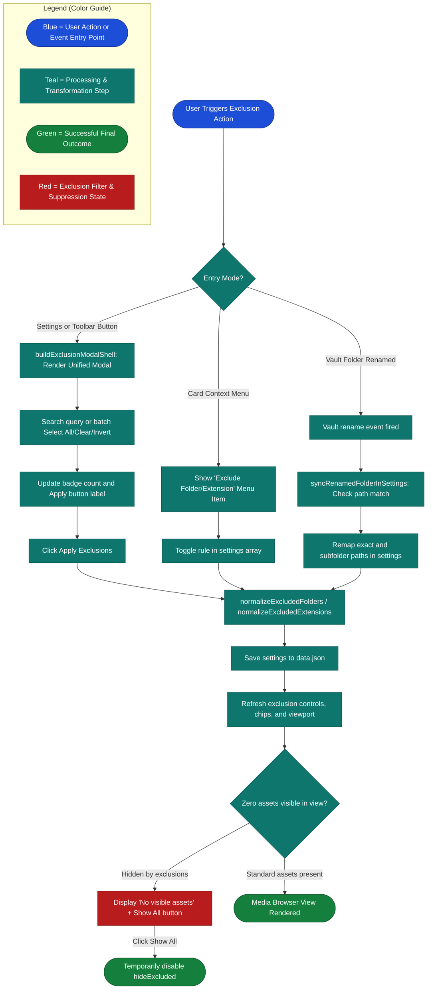

# Visual Feature & Change Log (`VISUAL_LOG.md`)
> **1-Line Summary:** Plain-English, color-coded Obsidian-compatible Mermaid flowcharts explaining how each major flow in Note Toolbox operates end to end.

## Feature & Change Flowcharts

### [VISUAL: Media-Browser-And-Lightbox-Flow] | Aliases: media toolbox modal, quick look, asset picker
> **1-Line Summary:** How the Media Toolbox modal scans, filters, and renders vault assets, and triggers the QuickLook lightbox preview.

* **Plain-English Walkthrough:** When the user launches Media Toolbox or an external plugin requests an asset picker, `MediaService` queries the vault. Files are filtered through inclusion and exclusion rules (skipping configured folders or extensions). Results are rendered in a CSS-virtualized responsive grid. Clicking an item enables selection; clicking preview opens the `QuickLookModal` lightbox for full-resolution inspection. Selecting an asset resolves the picker Promise or inserts Markdown embeds.

```mermaid
flowchart TD
    %% Color Definitions (Obsidian & GitHub compatible)
    classDef startNode fill:#1d4ed8,stroke:#1e3a8a,color:#ffffff
    classDef processNode fill:#0f766e,stroke:#115e59,color:#ffffff
    classDef outputNode fill:#15803d,stroke:#14532d,color:#ffffff
    classDef trapNode fill:#b91c1c,stroke:#7f1d1d,color:#ffffff

    Start([User / External Plugin opens Media Toolbox]):::startNode --> QueryFiles[Scan vault files via app.vault.getFiles]:::processNode
    QueryFiles --> FilterRules{Check excludedFolders & excludedExtensions?}:::processNode

    FilterRules -->|Excluded| SkipItem[Discard file from browser view]:::processNode
    FilterRules -->|Included| Classify[fuzzy.ts: Categorize as image, video, audio, doc]:::processNode
    SkipItem --> VirtualGrid[Render in CSS-virtualized 3-tier grid]:::processNode
    Classify --> VirtualGrid

    VirtualGrid --> UserAction{User Action on Item?}:::processNode
    UserAction -->|Click Lightbox / Space| OpenLightbox[Open QuickLookModal full-res view]:::processNode
    UserAction -->|Select & Insert| InsertChoice{Triggered as inter-plugin picker?}:::processNode

    OpenLightbox --> DoneView([Lightbox Displayed with Zoom / Pan]):::outputNode
    InsertChoice -->|Yes| ResolvePromise[Resolve openImagePicker / pickAsset Promise]:::processNode
    InsertChoice -->|No| InsertMarkdown[editor.replaceSelection: Insert ![[embed]]]:::processNode

    ResolvePromise --> CloseModal([Modal Closed & Selection Dispatched]):::outputNode
    InsertMarkdown --> CloseModal

    subgraph Legend["Legend (Color Guide)"]
        L1([Blue = Starting User Action / Entry Point]):::startNode
        L2[Teal = Processing & Transformation Step]:::processNode
        L3([Green = Successful Final Outcome]):::outputNode
        L4[Red = Filter & Exclusion Guard]:::trapNode
    end
```

* **Code Anchors (Grep Targets):**
  * `src/media-toolbox.ts` -> `MediaToolboxModal.render`, `renderViewport`
  * `src/media.ts` -> `MediaService.scanMedia`
  * `src/quick-look.ts` -> `QuickLookModal.open`

---

### [VISUAL: Inline-Dropdown-Manager-Flow] | Aliases: dropdown processor, frontmatter bind, dropdown lists
> **1-Line Summary:** How inline `?[list]` tags in Markdown notes are parsed, rendered into live dropdown controls, and synced to note properties.

* **Plain-English Walkthrough:** Note Toolbox registers a markdown post-processor for inline dropdown widgets (`?[listname]` or `?[listname|current]`). When Obsidian renders note preview blocks, the processor replaces match syntax with interactive dropdown selectors. When the user changes an option, the value is updated atomically inside note frontmatter using `app.fileManager.processFrontMatter` without disrupting Markdown contents.

```mermaid
flowchart TD
    %% Color Definitions (Obsidian & GitHub compatible)
    classDef startNode fill:#1d4ed8,stroke:#1e3a8a,color:#ffffff
    classDef processNode fill:#0f766e,stroke:#115e59,color:#ffffff
    classDef outputNode fill:#15803d,stroke:#14532d,color:#ffffff
    classDef trapNode fill:#b91c1c,stroke:#7f1d1d,color:#ffffff

    Start([Markdown Reading View Renders Note]):::startNode --> ScanSyntax[Scan text for ?[listname] or ?[listname|val] syntax]:::processNode
    ScanSyntax --> MatchFound{Inline dropdown pattern matched?}:::processNode

    MatchFound -->|No| NativeRender([Standard Markdown DOM]):::outputNode
    MatchFound -->|Yes| QueryList[Query dropdownLists from data.json]:::processNode

    QueryList --> BuildSelect[Build HTML select element with styled options]:::processNode
    BuildSelect --> AttachListener[Attach change listener via voidAsync]:::processNode

    AttachListener --> SelectionChange[/User selects new dropdown option/]:::processNode
    SelectionChange --> AtomicWrite[app.fileManager.processFrontMatter: Update YAML]:::processNode

    AtomicWrite --> SyncDone([Frontmatter & Property Synced Atomically]):::outputNode

    subgraph Legend["Legend (Color Guide)"]
        L1([Blue = Starting Event / Entry Point]):::startNode
        L2[Teal = Processing & Transformation Step]:::processNode
        L3([Green = Successful Final Outcome]):::outputNode
        L4[Red = Pattern Mismatch Branch]:::trapNode
    end
```

* **Code Anchors (Grep Targets):**
  * `src/dropdown.ts` -> `InlineDropdownProcessor`
  * `src/dropdown-manager.ts` -> `DropdownManager.updateList`
  * `src/main.ts` -> `registerMarkdownPostProcessor`

---

### [VISUAL: Exclusion-Management-And-Lifecycle-Flow] | Aliases: exclusions flow, red badge, modal shell, rename sync, show all
> **1-Line Summary:** How exclusion pickers standardize modal UI, normalize folder/extension paths, handle vault folder renames, and expose quick-toggle actions.

* **Plain-English Walkthrough:** Note Toolbox manages exclusions through both visual pickers and file context menus. In the visual modals (`FolderSelectorModal` and `ExtensionSelectorModal`), `buildExclusionModalShell` constructs a unified red-themed header with live excluded counts, search filtering, and batch actions (Select All / Clear All / Invert). Saved inputs are sanitized and deduplicated case-insensitively via `normalizeExcludedFolders` and `normalizeExcludedExtensions`. When a vault folder is renamed, `syncRenamedFolderInSettings` automatically remaps affected rules so exclusion coverage remains intact. In the media browser, context menus allow toggling folder/extension rules on the fly, and empty views offer a "Show All" button to temporarily view assets hidden by active exclusions.



* **Code Anchors (Grep Targets):**
  * `src/exclusions.ts` -> `buildExclusionModalShell`, `normalizeExcludedFolders`, `normalizeExcludedExtensions`
  * `src/main.ts` -> `NoteToolboxPlugin.syncRenamedFolderInSettings`
  * `src/media-toolbox.ts` -> `MediaToolboxModal.showContextMenu`, `MediaToolboxModal.renderViewport`
